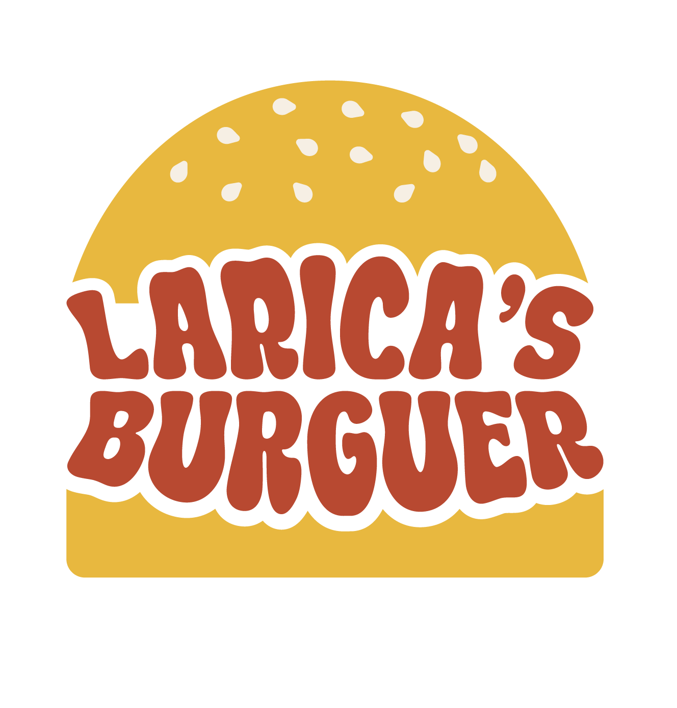

<div align="center">



# 🍔 Larica's Burguer — Landing Page

**Landing page institucional da hamburgueria artesanal fictícia _Larica's Burguer_, de Salvador/BA.**

🇧🇷 Português · [🇺🇸 English](README.en.md)

🔗 **[Acessar o site ao vivo](https://laricasburguerunime.vercel.app/)**


</div>

---

## 📖 Sobre o projeto

Este projeto é a landing page da **Larica's Burguer**, uma empresa **fictícia** criada por uma equipe de estudantes da **UniAnhanguera** como parte de um trabalho acadêmico. O site apresenta a marca, sua cultura organizacional, o time e o cardápio.

No universo do projeto, a Larica's Burguer é uma hamburgueria artesanal de Salvador com **modelo híbrido**: o salão funciona em uma cozinha no **Rio Vermelho**, enquanto o delivery (próprio e iFood) sai de **Dark Kitchens** separadas pela cidade, garantindo velocidade e qualidade nos dois canais.

> ⚠️ **Projeto acadêmico**, desenvolvido para fins de aprendizado e sem fins comerciais. A empresa, o cardápio, os preços e os contatos são fictícios.

## ✨ Funcionalidades

- **Hero animado** com ilustração em [Lottie](https://airbnb.io/lottie/) (executada uma vez por sessão) e imagem estática de reserva caso a animação falhe.
- **Seção Cultura** com Missão, Visão e Valores.
- **Diagrama interativo de valores**: sete tags sobre a foto do hambúrguer que exibem um _popup_ ao passar o mouse ou receber foco do teclado.
- **Carrossel do time** com 12 colaboradores, setas, indicadores, navegação por **swipe** no mobile e _loop_ infinito.
- **Cardápio** com 5 hambúrgueres (incluindo uma opção vegetariana), com foto, descrição e preço.
- **Navbar inteligente**: esconde ao rolar para baixo, reaparece ao rolar para cima e destaca a seção ativa via `IntersectionObserver`.
- **Rolagem suave** entre âncoras, compensando a altura do cabeçalho.
- **Animações de revelação** ao rolar a página.
- **Design responsivo** com breakpoints em 1024px, 768px e 420px e menu hambúrguer no mobile.
- **Acessibilidade**: HTML semântico, `aria-*`, tooltips acessíveis por teclado e menu fechável com `Esc`.
- **SEO**: meta tags, palavras-chave e Open Graph.
- **Segurança**: cabeçalhos HTTP (CSP, HSTS, `X-Content-Type-Options`, `Referrer-Policy`, `Permissions-Policy`) configurados no `vercel.json`.

## 🛠️ Tecnologias

| Tecnologia | Uso |
| --- | --- |
| HTML5 | Estrutura semântica |
| CSS3 | Estilos, variáveis CSS, Grid/Flexbox e responsividade |
| JavaScript (ES6+) | Interações, carrossel, observers e menu mobile |
| [lottie-web](https://github.com/airbnb/lottie-web) 5.12.2 | Animação do hambúrguer (via cdnjs) |
| Fonte [Alexandria](https://fonts.google.com/specimen/Alexandria) | Tipografia (hospedada localmente em `.woff2`) |
| [Vercel](https://vercel.com/) | Hospedagem e cabeçalhos de segurança |

Sem frameworks, sem _bundlers_ e sem etapa de build.

## ☁️ Deploy

O site está publicado na **Vercel**: [https://laricasburguerunime.vercel.app/](https://laricasburguerunime.vercel.app/). O arquivo `vercel.json` reescreve a rota `/` para `/pages/index.html` e aplica os cabeçalhos de segurança. Não há etapa de build.

## 📁 Estrutura de pastas

```
website-laricas-burguer/
├── assets/
│   ├── animations/        # Animação Lottie (burgerAnimation.json)
│   ├── fonts/             # Fonte Alexandria (.woff2)
│   ├── icons/             # Logos, ícones sociais e setas do carrossel
│   └── photos/
│       ├── cardapio/      # Fotos dos hambúrgueres
│       ├── colaboradores/ # Fotos do time
│       └── secao_valores/ # Tags da seção de valores
├── css/
│   ├── estilos.css        # Ponto de entrada (@import dos demais)
│   ├── base.css           # Variáveis, reset, fonte e estilos globais
│   ├── componentes.css    # Navbar, carrossel, cardápio e rodapé
│   ├── cultura-valores.css# Seção de cultura, missão, visão e valores
│   └── responsivo.css     # Media queries
├── js/
│   ├── principal.js       # Menu, navbar, carrossel, scroll e animações
│   └── lottie-hamburguer.js # Carregamento da animação com fallback
├── pages/
│   └── index.html         # Página única
└── vercel.json            # Rewrites e cabeçalhos de segurança
```

## 🍔 Cardápio

| Item | Destaque | Preço |
| --- | --- | --- |
| **X-Lá Ele** | Carne de 150g, queijo coalho, calabresa defumada, bacon e geleia de pimenta | R$ 29,90 |
| **Quebradeira** | Duas carnes smash de 100g, cheddar cremoso, bacon e cebola caramelizada | R$ 25,90 |
| **Big Laranjada** | Dois smash de 100g, cheddar, farofa de bacon e anéis de cebola gigantes | R$ 32,90 |
| **X-Migué** 🌱 | Blend vegetariano de cogumelos e grãos, queijo e molho especial | R$ 25,90 |
| **Barril Dobrado** | Dois blends de 150g com cheddar e queijo prato | R$ 36,90 |

## 👥 Time (empresa fictícia)

| Nome | Cargo |
| --- | --- |
| Nélia | Gerente Geral |
| Amanda Santiago | Coordenadora |
| Nicole Cardoso | Gerente de RH |
| Elaine Maciel | Gerente Financeiro |
| Andreza Portugal | Gerente de Marketing |
| Igor Fiuza | Gerente de Operações |
| Letícia Silva | Gerente de Relacionamentos |
| Franciele Menezes | Chef de Cozinha |
| Evelyn Araújo | Subchef de Cozinha |
| Nadson Veloso | Gerente de Logística e Frota |
| João Lucas Santos | Gerente de Suprimentos (Compras) |
| Rayan Nogueira | Gerente de Inovação e T.I. |

## 🎓 Contexto acadêmico

Desenvolvido para uma equipe de estudantes da **UniAnhanguera** como material de divulgação da empresa fictícia **Larica's Burguer**.

## 👨‍💻 Autor

Desenvolvido por **[@pedrohenriquefalcao](https://github.com/pedrohenriquefalcao)**.

---

<div align="center">

Feito com 🧡 e muita larica.

</div>
